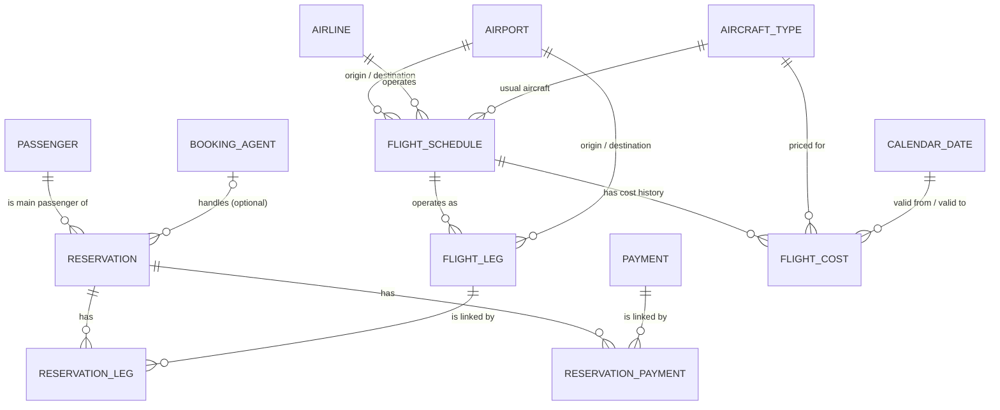

# HarborWing Air — Database (Midterm Drill, Part 1)

A MySQL 8 relational database that replaces HarborWing's reservation spreadsheets.
The CRUD application that uses it lives in [`../application`](../application/README.md).

| File | What it is |
|---|---|
| `schema.sql` | Creates the database: tables, keys, constraints, indexes (running it **resets** everything) |
| `seed.py` | Faker script: resets + fills every table (fixed seed = same data every time) |
| `requirements.txt` | Python packages for the seed script |
| `.env.example` | Template for your database login (copy to `.env`) |
| `queries.sql` | The four required example queries + evidence queries |
| `row_counts.sql` | Row count of every table |
| `harborwing.mwb` / `harborwing_eer.png` | MySQL Workbench model and exported diagram (you create these — see GUIDE.md step 5) |

---

## 1. Quick start (for another developer)

Requirements: MySQL Server 8.0.16+ (for CHECK constraints), Python 3.9+, MySQL Workbench (for the diagram).

```bash
cd database
python -m venv .venv
# Windows: .venv\Scripts\activate      macOS/Linux: source .venv/bin/activate
pip install -r requirements.txt
copy .env.example .env        # macOS/Linux: cp .env.example .env   -> then edit the password
python seed.py                # creates + resets + seeds the database, prints row counts
```

Then open `queries.sql` and `row_counts.sql` in MySQL Workbench and run them (lightning-bolt icon).

**Reset process:** run `python seed.py` again. It always runs `schema.sql` first (drop + recreate),
then inserts the same data because the seed is fixed (`SEED = 2026` at the top of `seed.py`).
You can also reset without data by running `schema.sql` alone in Workbench.

Optional: `python seed.py --sql-out seed_data.sql` also writes all INSERTs to a file you can run in Workbench;
`python seed.py --dry-run` only generates and checks the data (no database needed).

---

## 2. Tables

### Core tables (11)
| Table | Purpose | Key |
|---|---|---|
| `booking_agent` | Travel agents who book for passengers | `agent_id` (auto) |
| `passenger` | The **main** passenger of each reservation, stored once | `passenger_id` (auto), email unique |
| `reservation` | A booking: main passenger, optional agent, status / ticket / class codes, creation time, party size | `reservation_id` (auto) |
| `payment` | One money transaction (status, date, positive amount) | `payment_id` (auto) |
| `airport` | Airports with a consistent 3-letter code (fixes inconsistent airport names) | `airport_code` |
| `flight_schedule` | The planned flight: airline, usual aircraft, route, **scheduled** times | `flight_number` |
| `flight_leg` | One operated flight of a schedule with **actual** times (NULL until it flies) | `leg_id` (auto) |
| `calendar_date` | One row per day 2025-01-01 → 2027-12-31 with day-of-month and business-day flag | `day_date` |
| `flight_cost` | Cost history per flight + aircraft type + validity period | (`flight_number`, `aircraft_type_code`, `valid_from_date`) |
| `reservation_payment` | Link: which payments belong to which reservations | (`reservation_id`, `payment_id`) |
| `reservation_leg` | Link: which legs belong to which reservations | (`reservation_id`, `leg_id`) |

### Supporting reference tables (2)
| Table | Purpose |
|---|---|
| `airline` | Airline codes used by schedules. `HW` = HarborWing; the other 49 are fictional **DEMO** rows (`is_demo_data = TRUE`, name ends in "(DEMO)") added to reach 50 rows |
| `aircraft_type` | Aircraft type codes used by schedules and costs. All 50 are **DEMO** codes (`DM001`…`DM050`) |

**Code lists** that are too small to need a table are enforced with `CHECK` constraints and documented here:

| Column | Allowed codes |
|---|---|
| `reservation.reservation_status_code` | PEND (pending), CONF (confirmed), CANC (cancelled), COMP (completed) |
| `reservation.ticket_type_code` | ONEWAY, RETURN, MULTI |
| `reservation.travel_class_code` | ECON, PREM, BUS, FIRST |
| `payment.payment_status_code` | PEND, PAID, REFD (refunded), FAIL |

---

## 3. How the tables relate



* Every reservation has exactly **one** main passenger (`passenger_id NOT NULL`); a passenger has 0..many reservations.
* A reservation has **0 or 1** agent (`agent_id NULL`); an agent has 0..many reservations.
* Reservations ↔ payments and reservations ↔ legs are **many-to-many**, so each uses a linking table.
* Every leg belongs to exactly one schedule; a schedule has 0..many legs and 0..many cost records.
* Every schedule and leg has one origin and one destination airport (two FKs to `airport`) and they must differ.

### Constraints that enforce the business rules
| Rule | How |
|---|---|
| Party size > 0 | `CHECK (number_in_party > 0)` |
| Payment amount positive | `CHECK (payment_amount > 0)` |
| Cost not negative | `CHECK (cost_amount >= 0)` |
| Origin ≠ destination | `CHECK (origin_airport_code <> destination_airport_code)` on schedule and leg |
| Arrival after departure | CHECK on scheduled times; on actual times only when both are known |
| valid_to ≥ valid_from | `CHECK (valid_to_date >= valid_from_date)` |
| Validity dates must exist in calendar | two FKs to `calendar_date` |
| No duplicate link pairs | composite PRIMARY KEY on both linking tables |
| No allocation amount in links | linking tables only contain the two IDs |
| Consistent airport codes | `airport_code CHAR(3)` + CHECK for 3 capital letters, FKs everywhere else |

### Indexes
Primary keys and foreign keys are indexed automatically by InnoDB. Extra indexes support common searches:
passenger email (unique), schedule route (`origin, destination`), schedule departure time, leg actual departure,
reservation creation date and status, payment date, cost aircraft type and valid-to date, and the **second column** of
each linking table (`ix_rp_payment`, `ix_rl_leg`) so "which reservations use this payment/leg?" is fast.

### Deletion rules (documented policy)
| When you delete… | Result |
|---|---|
| a passenger that has reservations | **Blocked** (RESTRICT) |
| a booking agent | Allowed — their reservations become direct (`ON DELETE SET NULL`) |
| a reservation | Allowed — only its rows in the two linking tables are removed (`CASCADE`); payments and legs stay |
| a payment or leg still linked to a reservation | **Blocked** — remove the link first |
| an airport used by a schedule or leg | **Blocked** |
| a schedule that has legs or costs | **Blocked** |
| an airline, aircraft type or calendar date in use | **Blocked** |

---

## 4. Design explanations

**Why two linking tables?** One payment can cover several reservations, and one reservation can be paid in several
instalments — that is many-to-many, which a single foreign-key column cannot represent. The same is true for legs:
a reservation includes several connecting legs, and the same leg (one operated flight) carries many reservations.
The linking tables store each pair once, and their composite primary keys stop duplicate pairs — this fixes the
spreadsheet problems of duplicated payments and hard-to-track connecting legs.

**Why are scheduled and actual times separate?** The schedule is the plan; the leg is what really happened.
In the spreadsheet, typing actual times overwrote the plan, so delays could not be measured. Now
`flight_schedule` keeps the planned times and each `flight_leg` keeps its own actual times, which may be NULL
until the flight operates. All times are stored in **UTC** (column names end in `_utc`) so flights crossing time
zones compare correctly.

**Why does flight cost use a composite key?** A cost is only meaningful for a specific flight, a specific aircraft
type and a specific period. `(flight_number, aircraft_type_code, valid_from_date)` lets the same flight have many
cost rows over time, so a price change **adds** a row instead of overwriting the old cost — the history is kept.

**Simplifying assumption — flight number identifies a schedule.** Real airlines reuse flight numbers: the same
number can fly different routes on different days, change times by season, and the same digits are used by different
airlines. A production system would identify a schedule by something like airline code + flight number + effective
date range (+ days of operation), or a surrogate `schedule_id` with those as a unique key.

### Advantages
* Each fact is stored once (passengers, airports), so updates happen in one place and names stay consistent.
* Constraints and foreign keys stop invalid data at the database level, not just in the app.
* History is preserved (costs, scheduled vs actual times).
* InnoDB transactions let the app save several related rows all-or-nothing.

### Trade-offs and limitations
* **Shared payments don't show the split.** A payment linked to three reservations stores only the total; we can't
  tell how much belongs to each reservation (the rules forbid an allocation column). Summing payments across
  reservations would double count shared payments.
* **Party size doesn't identify travellers.** We store the main passenger and `number_in_party`, not the names of
  the other travellers, so we can't produce a passenger manifest per seat.
* **More tables = more joins.** Separating data removes duplication but every report needs joins, and careless
  joins can inflate totals (see query 1 below for the safe pattern).
* **Overlapping cost periods need a policy.** The schema checks valid_to ≥ valid_from but cannot stop two periods
  overlapping with a simple constraint. Policy: periods for the same flight + aircraft type must not overlap; the seed
  script generates consecutive periods and the app rejects overlaps. If an overlap ever exists, the lookup query
  uses the period that started most recently.
* Code lists enforced by CHECK need an `ALTER TABLE` to add a new code.
* Legs are created for future flights with NULL actual times, so the operating date of a not-yet-flown leg is not
  stored separately (it is implied by the schedule).

---

## 5. Example queries (full versions in `queries.sql`)

1. **Reservation with passenger, agent, payments and legs** — payments and legs are each aggregated in their own
   subquery, then joined. Joining both directly would give *payments × legs* rows and inflate `SUM(payment_amount)`.
2. **Reservations using a leg** — `reservation_leg` → `reservation` → `passenger` filtered by `leg_id`.
3. **Payments of a reservation** — `reservation_payment` → `payment`, plus how many reservations share each payment.
4. **Cost for a flight + aircraft type + date** — `WHERE @date BETWEEN valid_from_date AND valid_to_date ORDER BY valid_from_date DESC LIMIT 1`.

## 6. Synthetic data
`seed.py` uses **Faker** with `SEED = 2026` and a fixed "today" (2026-10-14), so every run produces identical data.
Emails use `example.com`, addresses use "Fictional Coast", and all airline/aircraft filler codes are labelled DEMO —
nothing is real personal data. It inserts parents before children, only uses keys it has already created, uses sets to
prevent duplicate link pairs, and generates: direct and agent reservations, reservations with several payments and several
legs (connecting legs through hub airports), payments shared by 2–3 reservations, and 1–3 consecutive cost periods per
flight/aircraft. `validate()` checks these rules before anything is inserted.

Approximate row counts: calendar_date 1095, reservation_leg ~600, reservation_payment ~450, payment ~400,
flight_leg 320, reservation 300, flight_cost ~230, passenger 200, flight_schedule 80, airport 60,
booking_agent 60, airline 50, aircraft_type 50 — all ≥ 50.
